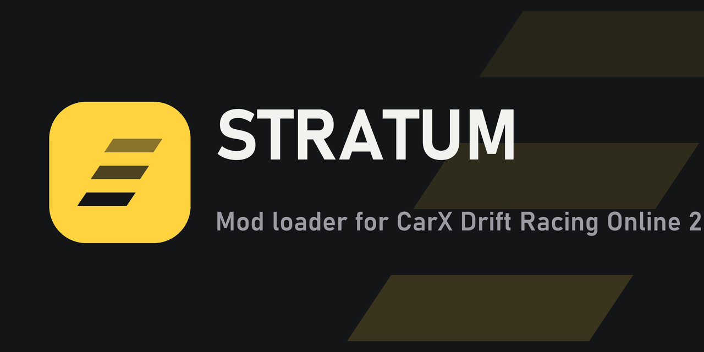

# Stratum SDK 1.0

C# mods for the **STRATUM** loader — **CarX Drift Racing Online 2**, Windows x64.
C#-моды для загрузчика **STRATUM** — **CarX Drift Racing Online 2**, Windows x64.


| | |
|---|---|
| **Stratum.API** | mod base class · a page in the STRATUM menu · rebindable hotkeys · multiplayer messages · direct access to Unity and CarX classes |
| **tools** | game references from your STRATUM install · one-command build · `.strmod` packer |
| **template\MyMod** | start here |
| **examples\ExampleMod** | every feature, with comments (+ prebuilt `.strmod`) |

Requires STRATUM **0.12+** (0.13 recommended) and the [.NET 8 SDK](https://dotnet.microsoft.com/download/dotnet/8.0). Players need the [.NET 8 Runtime x64](https://dotnet.microsoft.com/download/dotnet/8.0).

## Guide / Руководство

- 🇷🇺 [docs/GUIDE-RU.md](docs/GUIDE-RU.md) — полное руководство для игроков и мододелов
- 🇬🇧 [docs/GUIDE-EN.md](docs/GUIDE-EN.md) — complete guide for players and modders
- [docs/guide.html](docs/guide.html) — the Russian guide as a web page
- [CHANGELOG.md](CHANGELOG.md) — what's new / что нового

## Quick start / Быстрый старт

```powershell
.\tools\Get-GameReferences.ps1 -Game "C:\Program Files (x86)\Steam\steamapps\common\CarX Drift Racing Online 2"
.\tools\Build-Mod.ps1 -Project .\template\MyMod
# copy template\MyMod\dist\MyMod-1.0.0.strmod to <game>\STRATUM\Mods
```

```csharp
using Stratum;

[StratumMod("yourname.mymod", "My Mod", "1.0.0", Author = "Your name")]
public sealed class MyMod : StratumMod
{
    bool enabled = true;

    public override void OnLoad() => Input.Bind("toggle", "On/off", () => enabled = !enabled, Key.F8);

    public override void OnDrawUI()
    {
        UI.Toggle("Enabled", ref enabled);
        if (UI.Button("Say hello", primary: true)) Log.Info("Hello!");
    }
}
```

## Debugging / Отладка

Turn on **Settings → Developer console** in the STRATUM menu: `Log.Info`, `Log.Warning`, `Log.Error` and your mod's exceptions appear in a live console window.
Включите **Настройки → Консоль разработчика** в меню STRATUM: `Log.Info`, `Log.Warning`, `Log.Error` и исключения мода появляются в окне консоли сразу.

| Your mod in the menu / Ваш мод в меню | |
|---|---|
|  |  |
