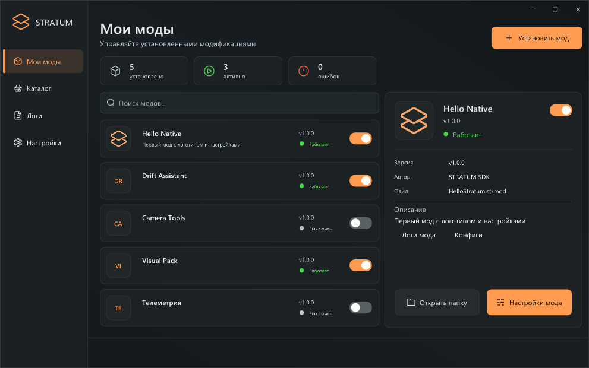

# C#-мод для STRATUM: от проекта до .strmod

SDK **0.9.1**, загрузчик **0.9.0**, Windows x64, Native ABI 1, пакет v2.

## 1. Подготовка

Установите **.NET 10 SDK** и **Visual Studio 2022 или новее / Build Tools** с компонентами **Desktop development with C++**, x64 MSVC и Windows SDK. Распакуйте SDK в папку с правом записи, вне папки игры.

Откройте PowerShell **в корне SDK**, где находятся csharp, bin и examples:

```powershell
dotnet --version
.\csharp\Build-Mod.ps1
```

dotnet должен показывать **10.x**. Скрипт соберёт **artifacts/HelloCSharp-1.0.0.strmod**. Первая сборка требует интернета для NuGet. Игроку инструменты сборки и отдельный .NET не нужны.

Без сборки можно проверить готовый **examples/HelloCSharp-1.0.0.strmod**.

## 2. Создание своего мода

Из корня SDK:

```powershell
Copy-Item .\csharp\HelloCSharp .\csharp\MyMod -Recurse
Rename-Item .\csharp\MyMod\HelloCSharp.csproj MyMod.csproj
```

| Файл | Что менять |
| --- | --- |
| csharp/MyMod/HelloMod.cs | Логику мода |
| csharp/MyMod/manifest.ini | ID, название, версию, автора и описание |
| csharp/MyMod/logo.png | Логотип; можно удалить |
| csharp/MyMod/MyMod.csproj | Зависимости и параметры проекта |

Имя класса HelloMod можно оставить: название в меню берётся из manifest.ini. При переименовании класса измените также **ModEntry.Initialize<HelloMod>**.

Сохраните соседние папки **csharp/Stratum.NativeAot** и **csharp/Notices**. При переносе проекта исправьте ProjectReference в .csproj.

## 3. Манифест и логотип

Сохраните manifest.ini в UTF-8, без пробелов вокруг `=`:

```ini
id=author.my_mod
name=Мой мод
version=1.0.0
author=Автор
description=Что делает мод и как им пользоваться.
```

- **id**: уникальный и постоянный; до 96 символов. Строчные латинские буквы, цифры, `.`, `_`, `-`; первый символ — буква или цифра. Нельзя использовать пути, зарезервированные имена Windows и точку в конце.
- **version**: три числа. При обновлении меняйте версию, сохраняя id.
- **name**, **author**: до 128 байт UTF-8; **description** — до 2048.
- **logo.png**: PNG до 4 МиБ, до 4096×4096. Код, манифест и логотип попадут в один .strmod.

## 4. Точка входа и жизненный цикл

В шаблоне оставьте Exports.Main с **[UnmanagedCallersOnly]**, EntryPoint **stratum_mod_main** и **Cdecl**. Экспорт должен находиться в основном проекте мода.

| Метод класса Mod | Назначение |
| --- | --- |
| OnLoad() | Инициализация и регистрация настроек |
| OnTick(float deltaSeconds) | Периодическая логика |
| OnRender(RenderFrame frame) | HUD; frame содержит DeltaSeconds, Width, Height |
| OnSettingChanged(string key, string value) | Применение сохранённого изменения настройки |
| OnUnload() | Остановка задач, хуков и подписок; true — отключён, false — нужен перезапуск |

Конструктор класса — public, без параметров. Обращайтесь к Host начиная с OnLoad. Повторное включение вызывает OnLoad у того же объекта: нужное состояние сбрасывайте самостоятельно.

## 5. Настройки, конфиги и логи

Регистрируйте настройки в OnLoad:

```csharp
var s = Host.Settings;
s.Toggle("hud", "Показывать HUD", true, group: "Общее");
s.Slider("speed", "Скорость", 2.5, 0.5, 5, 0.5);
s.Choice("style", "Стиль", "Carbon", ["Carbon", "Orange"]);
s.Keybind("action", "Клавиша действия", 119); // Windows VK_F8
```

Чтение значений:

```csharp
bool hud = Host.Settings.GetBool("hud");
double speed = Host.Settings.GetNumber("speed");
string style = Host.Settings.GetString("style");
int key = Host.Settings.GetKey("action");
Host.Log("Мод запущен");
Host.Log("Не удалось загрузить ресурс", LogLevel.Error);
```

- Максимум 64 поля. Не меняйте тип уже зарегистрированного ключа в текущей сессии.
- Slider: значение в диапазоне, с заданным шагом относительно minimum.
- Choice: 1–64 уникальных непустых варианта без `|`.
- Keybind: Windows VK для A–Z, 0–9, F1–F12, Space, Home, End, PageUp/PageDown или 0. Insert занят меню. Обработку нажатия пишет автор.
- После «Сохранить» STRATUM записывает значение и вызывает OnSettingChanged. Перечитайте настройки и обновите кэш состояния.
- Конфиг: **STRATUM/Configs/your.id/settings.cfg**. Не перезаписывайте его из мода. Свои данные храните в отдельных файлах внутри **Host.ConfigDirectory**.

## 6. HUD и потоки

Вызывайте рисование только внутри OnRender:

```csharp
Host.DrawRectangle(24, 24, 300, 56, Color.Rgba(25, 30, 32, 235));
Host.DrawText(40, 40, Color.Rgba(255, 157, 81), "Мой HUD");
```

Координаты — пиксели игрового окна. Кэшируйте настройки; не читайте файлы каждый кадр.

OnRender выполняется в D3D11 Present, остальные callbacks — рабочим потоком STRATUM. **Это не гарантированный Unity main thread.** SDK предоставляет настройки, логи, пути и HUD. Готовых игровых C#-классов, Unity/BepInEx/Harmony API и диспетчера главного потока нет.

## 7. Сборка своего .strmod

Из корня SDK:

```powershell
.\csharp\Build-Mod.ps1 -Project .\csharp\MyMod\MyMod.csproj
```

Результат: **artifacts/MyMod-1.0.0.strmod**. Существующий результат не перезаписывается. Для повторной сборки измените version либо задайте новое имя:

```powershell
.\csharp\Build-Mod.ps1 -Project .\csharp\MyMod\MyMod.csproj `
  -Output .\artifacts\MyMod-test2.strmod
```

При необходимости добавьте **-DotNet 'D:\Tools\dotnet\dotnet.exe'**, указывая SDK 10.x. **-UseEnvironmentalTools** нужен только при самостоятельно настроенных PATH/LIB переносимого MSVC.

В .csproj должны остаться:

```xml
<TargetFramework>net10.0</TargetFramework>
<PublishAot>true</PublishAot>
<NativeLib>Shared</NativeLib>
<RuntimeIdentifier>win-x64</RuntimeIdentifier>
```

**Обычный dotnet build не создаёт готовый нативный мод.** Не упаковывайте промежуточные DLL из bin/obj вместо результата Native AOT publish.

## 8. Установка и проверка

1. Импортируйте .strmod через «Установить мод» либо положите в **STRATUM/Mods** рядом с игрой.
2. Запустите игру через Steam, нажмите **Insert**.
3. Проверьте состояние мода, его настройки и логи. При включённом автозапуске импортов новый мод активируется сразу.
4. Проверьте изменение настроек, выключение и повторное включение.
5. **Закройте игру перед заменой загруженного пакета**: DLL удерживается до выхода.

В игру копируется только пакет. SDK, bin, obj, publish и Stratum.NativeAot.dll не нужны. Компоненты runtime включены в код мода. Внешние нативные зависимости, добавленные автором, могут требовать отдельных файлов.




## 9. Типовые ошибки

| Проблема | Решение |
| --- | --- |
| Требуется .NET 10 SDK | Установите SDK 10.x и проверьте dotnet --version |
| Platform linker not found / LNK1104 | Установите x64 MSVC и Windows SDK через C++ Build Tools; проверьте компоненты установки |
| Managed DLL / нужна нативная сборка | Используйте Build-Mod.ps1, не DLL из обычного dotnet build |
| Missing stratum_mod_main export | Верните атрибут, имя и сигнатуру Exports.Main в основной проект |
| Output exists | Измените версию либо -Output |
| IL2026 / IL3050 / trimming warnings | Исправьте несовместимую рефлексию или зависимость; не скрывайте предупреждения |
| Native DLL load failed | Проверьте Windows x64, внешние зависимости и целостность пакета |
| Файл занят | Закройте игру перед заменой пакета |
| Нет UnityEngine/BepInEx | Перенесите игровой функционал на нативную интеграцию; старый API отсутствует |

Обычные исключения экспортированных callbacks перехватываются SDK. Ошибка OnLoad означает отказ загрузки, OnUnload — необходимость перезапуска. Ошибка OnTick/OnRender/OnSettingChanged записывается в лог и приостанавливает callbacks до следующего OnLoad; переключатель ABI 1 может оставаться включённым. Фатальные native-сбои и ошибки собственных фоновых задач этим механизмом не покрываются.

## 10. Публикация

- Проверьте id, version, описание, логотип и работу в игре.
- Публикуйте готовый **.strmod**. Не добавляйте исходники, bin/obj, IL DLL и PDB, если распространяете только бинарный мод.
- Укажите **STRATUM Native 0.9.0+, Native ABI 1, Windows x64, формат .strmod v2**.
- Сохраните лицензии зависимостей. Тексты из csharp/Notices встроены в обёртку; при обновлении .NET обновляйте уведомления.
- Старые C# DLL требуют исходников, адаптации и пересборки. Native AOT не поддерживает динамическую загрузку managed DLL через Assembly.Load и Reflection.Emit.
- Машинный код можно исследовать. SHA-256 проверяет целостность пакета, не удостоверяет автора.

Справка: [Native ABI / C++](API-RU.md) · [Проверенные сценарии и ограничения](CSHARP-AOT-VERIFICATION.md).
