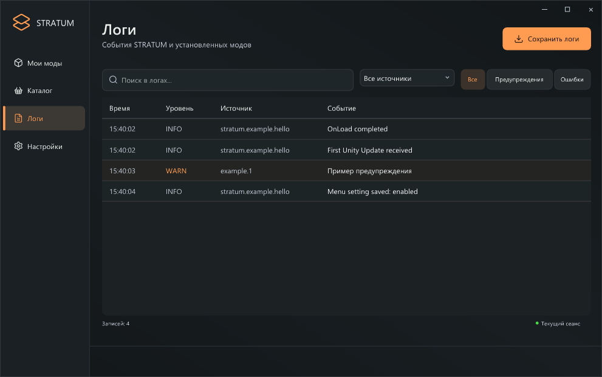
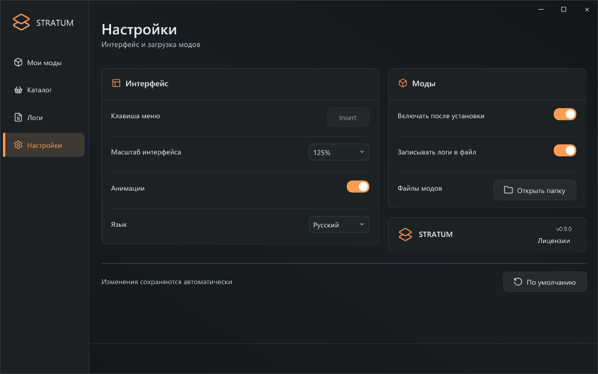

# STRATUM Native 0.9.0 — Native ABI 1 / SDK 0.9.1

[English](API-EN.md)

Это нативный загрузчик для **CarX Drift Racing Online 2 / Windows x64**. В поставке игрока один `winhttp.dll`. При работе создаются `STRATUM/Mods`, `STRATUM/Configs` и `STRATUM/Logs`. Отдельные .NET, Mono, BepInEx, launcher, внешние файлы runtime и распаковка библиотек загрузчика не используются. C#-моды можно собирать через **[Native AOT SDK](CSHARP-AOT-RU.md)**: компоненты их среды выполнения включены в нативный код самого пакета.

**Это новый Native ABI v1 и формат .strmod v2.** Прежний C# API STRATUM v1, BepInEx DLL и ZIP-пакеты .strmod v1 несовместимы. Замены расширения недостаточно: автор адаптирует исходники к новому интерфейсу и собирает нативную DLL на C++ либо C# Native AOT. Для SDK 0.9.1 замена игрового winhttp.dll версии 0.9.0 не требуется.

## 1. Установка и интерфейс

Закройте игру и положите подписанный winhttp.dll рядом с игровым EXE. Запускайте игру через Steam. Меню скрыто до Insert. Масштаб по умолчанию 125%; выбранный масштаб сохраняется. Список модов, поиск, правая карточка, логи, настройки и анимации сохранены.

Native .strmod импортируется через «Установить мод» либо помещается в STRATUM/Mods. Файл загружается автоматически. Папка может содержать один упакованный мод и дополнительные нативные библиотеки/ресурсы. Папки без DLL не считаются модами. Загруженный DLL заблокирован для записи до выхода из игры: обновляйте его при закрытой игре.

Переключатель меняет Configs/mods.cfg, а не имя загруженного DLL. on_unload с результатом 0 подтверждает отключение; другой результат показывает необходимость перезапуска. Сборка и статические переменные остаются в памяти. При повторном включении снова вызывается on_load.


Изображения интерфейса ниже используют демонстрационные данные.

## 2. Содержимое SDK

```text
include/stratum.h                  публичный C ABI, без import library
bin/stratum-pack.exe               нативный упаковщик и инспектор
examples/HelloNative/              исходник, manifest.ini, PNG, Build.ps1
examples/HelloNative-1.0.0.strmod    готовый пример для импорта
docs/API-RU.md                     это руководство
csharp/Stratum.NativeAot/          C#-обёртка Native ABI 1, исходники
csharp/HelloCSharp/                C# Native AOT пример, manifest и PNG
csharp/Build-Mod.ps1               publish → pack → inspect
examples/HelloCSharp-1.0.0.strmod    готовый C# AOT пример
docs/CSHARP-AOT-RU.md               руководство для C#
```

Для C++ нужен Windows x64 C++ компилятор. Пример проверен с Zig 0.14.1. .NET SDK и Python для сборки C++-мода не нужны. Для MSVC используйте статический CRT /MT и x64. Не меняйте выравнивание структур stratum.h и не передавайте STL-типы через ABI. Для C# Native AOT разработчику нужны .NET 10 SDK, MSVC и Windows SDK; игроку эти инструменты не нужны.

## 3. Первая сборка

Из корня распакованного SDK:

```powershell
.\examples\HelloNative\Build.ps1 -Zig 'D:\Tools\zig\zig.exe'
```

Результат: artifacts/HelloNative-1.0.0.strmod. Существующий результат не заменяется. При повторной сборке укажите -Output с новым именем либо обновите версию.

Вручную:

```powershell
zig c++ -target x86_64-windows-gnu -std=c++20 -O2 -shared -static -s -Iinclude examples/HelloNative/HelloNative.cpp -o MyMod.dll
.\bin\stratum-pack.exe pack MyMod.dll examples/HelloNative/manifest.ini examples/HelloNative/logo.png MyMod-1.0.0.strmod
.\bin\stratum-pack.exe inspect MyMod-1.0.0.strmod
```

Вместо пути к PNG передайте `-`, если логотип не нужен. Не публикуйте промежуточные PDB, объектные файлы и приватные исходники, если хотите распространять только бинарный мод.

## 4. Метаданные и один файл мода

manifest.ini — UTF-8, без пробелов вокруг знака `=`:

```ini
id=myname.my_mod
name=Мой нативный мод
version=1.0.0
author=Автор
description=Описание для карточки STRATUM.
```

ID: до 96 ASCII-символов, строчные буквы, цифры, точка, подчёркивание и дефис; первый символ буква/цифра. Запрещены зарезервированные имена Windows, конечная точка и пути. Версия — три числовых компонента. Имя и автор — до 128 байт UTF-8, описание — до 2048. PNG — до 4 МиБ; размеры изображения до 4096×4096. В меню логотип уменьшается до 128 пикселей.

Пакет v2 — PE DLL с добавленными метаданными, PNG и footer с SHA-256. Это **не ZIP** и не зашифрованный архив. Код остаётся машинным кодом; это относится и к C# Native AOT. Изображение и описание не являются секретными. Инспекция читает PE/экспорты и метаданные без исполнения DllMain или точки входа.

Один пакет — одна основная DLL. Дополнительные игровые ресурсы можно встроить в DLL средствами компилятора. Для внешних ресурсов/нативных зависимостей используйте папку мода. Максимум: 512 МиБ на файл/папку и 4096 файлов в папке. Ссылки и junction не поддерживаются.

## 5. Точка входа

Включите stratum.h и экспортируйте функцию с точным именем stratum_mod_main:

```cpp
#include "stratum.h"
static const StratumHost* host;
static int32_t STRATUM_CALL load(void*) {
    host->log(host, 0, "Mod loaded");
    return 0;
}
static int32_t STRATUM_CALL unload(void*) {
    // Stop owned hooks, jobs and callbacks here.
    return 0;
}
extern "C" STRATUM_EXPORT int32_t STRATUM_CALL stratum_mod_main(
    const StratumHost* api, StratumPlugin* plugin) {
    if (!api || !plugin || api->abi_version != STRATUM_NATIVE_ABI ||
        api->struct_size < sizeof(StratumHost) ||
        plugin->struct_size < sizeof(StratumPlugin)) return 1;
    host = api;
    *plugin = {sizeof(StratumPlugin), STRATUM_NATIVE_ABI,
               nullptr, load, unload, nullptr, nullptr, nullptr};
    return 0;
}
```

Возвращайте 0 при успехе. user — непрозрачный указатель на состояние мода; STRATUM не выделяет и не освобождает его. Не сохраняйте ссылки на временные строки callback. Не бросайте исключения через C ABI. Не вызывайте Host API из DllMain, не выполняйте там сложную инициализацию.

## 6. Потоки и жизнь модуля

- stratum_mod_main, on_load, on_unload, on_tick и on_setting_changed вызываются последовательно рабочим потоком STRATUM внутри процесса игры.
- on_render вызывается потоком D3D11 Present при активном игровом рендерере. Меню может быть закрыто; HUD мода продолжает работать. При неактивном/скрытом игровом окне callback может не вызываться.
- **Ни один из этих callback не обещает выполнение в главном потоке Unity.** Для доступа к игровым объектам нужен собственный корректный механизм интеграции с нативной игрой. Готового эквивалента UnityEngine/IL2CPP C# interop этот SDK не предоставляет.
- Callback одного мода не исполняются параллельно. Настройки объявляйте в on_load. get_setting и log можно использовать из собственных потоков, остановив их в on_unload.
- Не выполняйте длительный I/O или бесконечные ожидания в callback: это задержит другие моды/рендер. Аварийное завершение игры не гарантирует вызов on_unload; сохраняйте важные данные заранее.

Зависимости, типизированные C#-события и сервисы старого API автоматически не переносятся. Новый ABI предоставляет жизненный цикл, настройки, логи и простые команды рисования. Межмодовые протоколы и полноценный SDK игровых типов требуют отдельной разработки.

## 7. Настройки в меню

До 64 полей на мод. Схема StratumSetting содержит размер структуры, key, kind, group, label, description, default_value, numeric bounds и choices. Все строки UTF-8. Ключ до 96 ASCII-символов. Поддерживаются:

| kind | Значение | Пример |
| --- | --- | --- |
| toggle | true / false | "true" |
| slider | конечное число в границах, кратное step от minimum | "10" |
| choice | один из вариантов, заданных через `\|` | "Carbon" |
| keybind | Windows VK; 0 без клавиши | "119" для F8 |

Insert занят меню. Для keybind допускаются A–Z, 0–9, F1–F12, Space, Home, End, PageUp/PageDown или 0. Настройка клавиши сама по себе не регистрирует обработчик ввода: мод использует её значение в собственной логике.

```cpp
StratumSetting s{sizeof(StratumSetting), "hud", "toggle", "Общее",
    "Показывать HUD", "", "true", 0, 0, 0, nullptr};
if (host->define_setting(host, &s)) return 1;
char value[32];
if (host->get_setting(host, "hud", value, sizeof value)) {
    // value is NUL-terminated; true or false.
}
```

define_setting: 0 успешно, ненулевое значение ошибка. get_setting возвращает необходимый размер с NUL; 0 означает отсутствие значения/ошибку. Можно сначала передать nullptr и capacity=0. Повторное объявление при on_load после отключения сохраняет выбранное значение.

В меню изменения остаются черновиком до «Сохранить». Значение проверяется и атомарно записывается в Configs/<id>/settings.cfg; затем вызывается on_setting_changed. Если запись не удалась, живое значение не меняется. «По умолчанию» заполняет черновик значениями автора; для применения нужен «Сохранить».

config_directory возвращает постоянный путь Configs/<id>; mod_directory — каталог основной DLL. Путь wchar_t нужен файловым функциям Windows. Настройки сериализуются в UTF-8 key=value с экранированием обратной косой черты и переводов строки.


## 8. Логи и HUD

host->log(host, level, message): 0 Info, 1 Warning, 2 Error. Сообщение до 8192 байт UTF-8. В меню есть поиск, уровень и источник. Отключение файлового логирования сохраняет текущий журнал в памяти.

on_render получает StratumFrame: размер структуры, delta_seconds, ширину и высоту игрового окна. draw_text и draw_rect действуют только внутри render callback. Координаты — пиксели от левого верхнего угла; цвет — STRATUM_RGBA. ImGui ABI наружу не передаётся.

```cpp
host->draw_rect(host, 24, 24, 300, 60, STRATUM_RGBA(25,30,32,230));
host->draw_text(host, 40, 40, STRATUM_RGBA(255,157,81,255), "Hello C++");
```





## 9. Перенос старого мода

Нужны исходники и участие автора. BasePlugin/IStratumMod и C#-классы нельзя превратить в native DLL переименованием файла. Перенесите обработчики в callbacks, настройки в StratumSetting, замените доступ к UnityEngine подходящей нативной интеграцией. Затем скомпилируйте x64 DLL, добавьте точку входа и упакуйте v2.

Прежние конфиги и пользовательские моды сохраняются при установке 0.9.0, но автоматически не конвертируются. Для отката сохранена резервная копия 0.8.0 с прежним runtime. Не подключайте старые API/Hosting/Unity DLL в новый нативный мод.

## 10. Защита и публикация

Сам DLL загрузчика подписан RSA-3072/SHA-256; проверка находится в C++, подпись — в footer того же файла. Внутри только открытый ключ. Отладочные символы удалены. DLL — машинный код без CLR-заголовка и управляемых сборок. Лицензии компонентов доступны в настройках загрузчика.

SHA-256 пакета мода обнаруживает повреждение, но **не удостоверяет автора**: авторской подписи модов в этой версии нет. Нативный мод имеет права игры; DllMain исполняется при фактической загрузке до вызова stratum_mod_main. Это не песочница. Ошибка нативного кода может завершить процесс игры.

C++ и один файл не запрещают дизассемблирование, отладку и анализ памяти. Не обещайте пользователям неизвлекаемый/невзламываемый клиент. Ключ подписи ядра, исходники самого загрузчика и внутренние сборочные артефакты не входят в SDK.

Для GitHub можно публиковать это руководство, include/stratum.h, пример и изображения. Моды распространяйте готовым .strmod. Не публикуйте закрытый ключ ядра. Указывайте STRATUM Native 0.9.0+, Native ABI 1, Windows x64 и формат v2 в описании выпуска.
