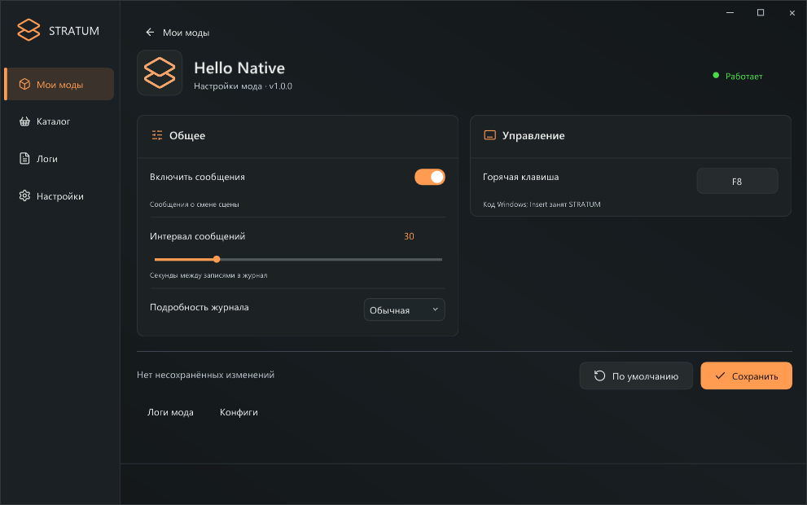

# Creating a C# mod for STRATUM

[Русский](CSHARP-AOT-RU.md) · **SDK 0.9.1 / loader 0.9.0 / Windows x64 / Native ABI 1 / .strmod v2**

## 1. Prepare the tools

Install **.NET 10 SDK** and **Visual Studio 2022 or newer / Build Tools** with **Desktop development with C++**, x64 MSVC and the Windows SDK. Extract the STRATUM SDK to a writable development folder outside the game directory.

Open PowerShell **at the SDK root**, which contains csharp, bin and examples:

```powershell
dotnet --version
.\csharp\Build-Mod.ps1
```

dotnet must report **10.x**. The script creates **artifacts/HelloCSharp-1.0.0.strmod**. The first build needs internet access for NuGet. Players do not need these build tools or a separate .NET installation.

To test without building, use **examples/HelloCSharp-1.0.0.strmod**.

## 2. Create your project

Run from the SDK root:

```powershell
Copy-Item .\csharp\HelloCSharp .\csharp\MyMod -Recurse
Rename-Item .\csharp\MyMod\HelloCSharp.csproj MyMod.csproj
```

| File | What to edit |
| --- | --- |
| csharp/MyMod/HelloMod.cs | Mod behavior |
| csharp/MyMod/manifest.ini | ID, display name, version, author and description |
| csharp/MyMod/logo.png | Logo; remove this file to build without one |
| csharp/MyMod/MyMod.csproj | Dependencies and project settings |

You can keep the class name HelloMod: the menu name comes from manifest.ini. If you rename the class, also update **ModEntry.Initialize<HelloMod>**.

Keep the neighboring **csharp/Stratum.NativeAot** and **csharp/Notices** folders. If you move the project, update its ProjectReference path.

## 3. Set metadata and logo

Save manifest.ini as UTF-8, without spaces around `=`:

```ini
id=author.my_mod
name=My Mod
version=1.0.0
author=Your Name
description=What the mod does and how to use it.
```

- **id**: unique and permanent; at most 96 characters. Use lowercase ASCII letters, digits, `.`, `_` and `-`; start with a letter or digit. Paths, reserved Windows device names and a trailing dot are invalid.
- **version**: three numeric components. Increase the version for updates and keep the same id.
- **name**, **author**: up to 128 UTF-8 bytes each; **description**: up to 2048.
- **logo.png**: PNG, up to 4 MiB and 4096×4096. Code, metadata and logo are included in one .strmod.

## 4. Keep the entry point and implement callbacks

Keep the template's Exports.Main method with **[UnmanagedCallersOnly]**, EntryPoint **stratum_mod_main**, and **Cdecl**. The export must be in the mod's main project.

| Mod method | Purpose |
| --- | --- |
| OnLoad() | Initialize the mod and register settings |
| OnTick(float deltaSeconds) | Periodic logic |
| OnRender(RenderFrame frame) | Draw HUD; frame has DeltaSeconds, Width and Height |
| OnSettingChanged(string key, string value) | Apply a saved setting change |
| OnUnload() | Stop owned jobs, hooks and subscriptions; true means stopped, false requires a game restart |

The mod class needs a public parameterless constructor. Access Host starting in OnLoad. Re-enabling calls OnLoad on the **same object**; reset your state as needed.

## 5. Settings, configuration and logs

Register settings in OnLoad:

```csharp
var s = Host.Settings;
s.Toggle("hud", "Show HUD", true, group: "General");
s.Slider("speed", "Speed", 2.5, 0.5, 5, 0.5);
s.Choice("style", "Style", "Carbon", ["Carbon", "Orange"]);
s.Keybind("action", "Action key", 119); // Windows VK_F8
```

Read settings and write logs:

```csharp
bool hud = Host.Settings.GetBool("hud");
double speed = Host.Settings.GetNumber("speed");
string style = Host.Settings.GetString("style");
int key = Host.Settings.GetKey("action");
Host.Log("Mod loaded");
Host.Log("Could not load a resource", LogLevel.Error);
```

- Maximum 64 fields per mod. Do not change a registered key's type during the session.
- Slider values must be in range and aligned to step relative to minimum.
- Choice takes 1–64 unique, nonempty values without `|`.
- Keybind accepts Windows VK codes for A–Z, 0–9, F1–F12, Space, Home, End, PageUp/PageDown, or 0. Insert is reserved for the menu. Implement the key's action yourself.
- After the user saves, STRATUM persists the value and calls OnSettingChanged. Read the updated settings and refresh your cached state.
- Settings are stored in **STRATUM/Configs/your.id/settings.cfg**. Let STRATUM manage this file. Store additional mod data in separate files inside **Host.ConfigDirectory**.

## 6. HUD and threading

Draw only inside OnRender:

```csharp
Host.DrawRectangle(24, 24, 300, 56, Color.Rgba(25, 30, 32, 235));
Host.DrawText(40, 40, Color.Rgba(255, 157, 81), "My HUD");
```

Coordinates are game-window pixels. Cache settings instead of reading files every frame.

OnRender runs on the D3D11 Present thread; the other callbacks run on STRATUM's worker thread. **Neither is guaranteed to be Unity's main thread.** The SDK provides settings, logs, paths and HUD drawing. It does not include game-type wrappers, the former Unity/BepInEx/Harmony APIs or a Unity main-thread dispatcher.

## 7. Build your .strmod

From the SDK root:

```powershell
.\csharp\Build-Mod.ps1 -Project .\csharp\MyMod\MyMod.csproj
```

Output: **artifacts/MyMod-1.0.0.strmod**. Existing output is not overwritten. For another build, change version or choose another filename:

```powershell
.\csharp\Build-Mod.ps1 -Project .\csharp\MyMod\MyMod.csproj `
  -Output .\artifacts\MyMod-test2.strmod
```

If needed, add **-DotNet 'D:\Tools\dotnet\dotnet.exe'** to select SDK 10.x. **-UseEnvironmentalTools** is only for an already configured portable MSVC PATH/LIB environment.

Keep these project properties:

```xml
<TargetFramework>net10.0</TargetFramework>
<PublishAot>true</PublishAot>
<NativeLib>Shared</NativeLib>
<RuntimeIdentifier>win-x64</RuntimeIdentifier>
```

**A regular dotnet build does not produce a native mod.** Use Native AOT publish output, not an intermediate DLL from bin/obj. Build-Mod.ps1 publishes, packs and inspects the result for you.

## 8. Install and test

1. Import the .strmod using **«Установить мод» (Install mod)** or place it in **STRATUM/Mods** next to the game.
2. Start the game through Steam and press **Insert**.
3. Check the mod status, settings and logs. New imports start automatically when automatic activation is enabled.
4. Test setting changes, disabling and re-enabling.
5. **Close the game before replacing a loaded package**: its DLL stays mapped until the process exits.

Deploy the package, not the SDK, bin, obj, publish or Stratum.NativeAot.dll. Required runtime components are compiled into the mod. Additional native dependencies introduced by the author may still require separate files.




## 9. Troubleshooting

| Problem | Fix |
| --- | --- |
| .NET 10 SDK required | Install SDK 10.x and check dotnet --version |
| Platform linker not found / LNK1104 | Install/check x64 MSVC and Windows SDK through C++ Build Tools |
| Managed DLL / native build required | Use Build-Mod.ps1, not a DLL from regular dotnet build |
| Missing stratum_mod_main export | Restore Exports.Main's attribute, exact entry-point name and signature in the main project |
| Output exists | Change version or -Output |
| IL2026 / IL3050 / trimming warnings | Fix incompatible reflection or dependencies; do not suppress warnings without resolving the cause |
| Native DLL load failed | Check Windows x64, external dependencies and package integrity |
| File is in use | Close the game before replacing the package |
| UnityEngine/BepInEx unavailable | Port game integration to the native environment; the previous API is absent |

The SDK catches ordinary exceptions in exported callbacks. OnLoad errors fail loading; OnUnload errors require a restart. OnTick/OnRender/OnSettingChanged errors are logged and pause SDK callbacks until the next OnLoad; the ABI 1 menu toggle may remain enabled. Fatal native faults and failures in your own background tasks are outside this mechanism.

## 10. Publish

- Test the ID, version, description, logo and behavior in the game.
- Release the finished **.strmod**. Omit source, bin/obj, intermediate IL DLLs and PDBs for a binary-only release.
- State **STRATUM Native 0.9.0+, Native ABI 1, Windows x64, .strmod v2** as requirements.
- Preserve dependency licenses. Texts in csharp/Notices are embedded in the wrapper; update notices when changing .NET versions.
- Existing managed C# DLLs need source adaptation and rebuilding. Native AOT does not support loading new managed DLLs through Assembly.Load or code generation through Reflection.Emit.
- Machine code remains inspectable. The package SHA-256 verifies integrity, not publisher identity.

Reference: [C++ / Native ABI](API-EN.md) · [Verification report, Russian](CSHARP-AOT-VERIFICATION.md).
