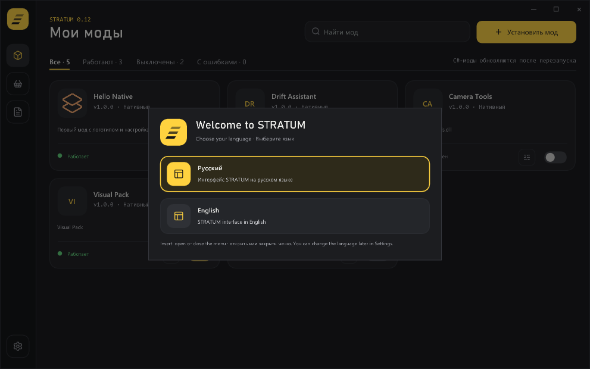
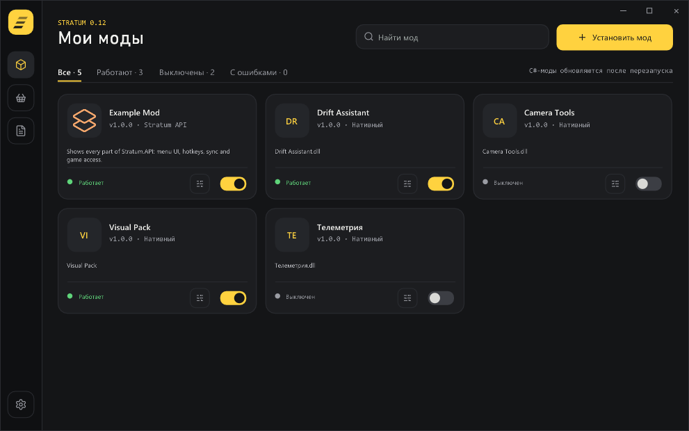
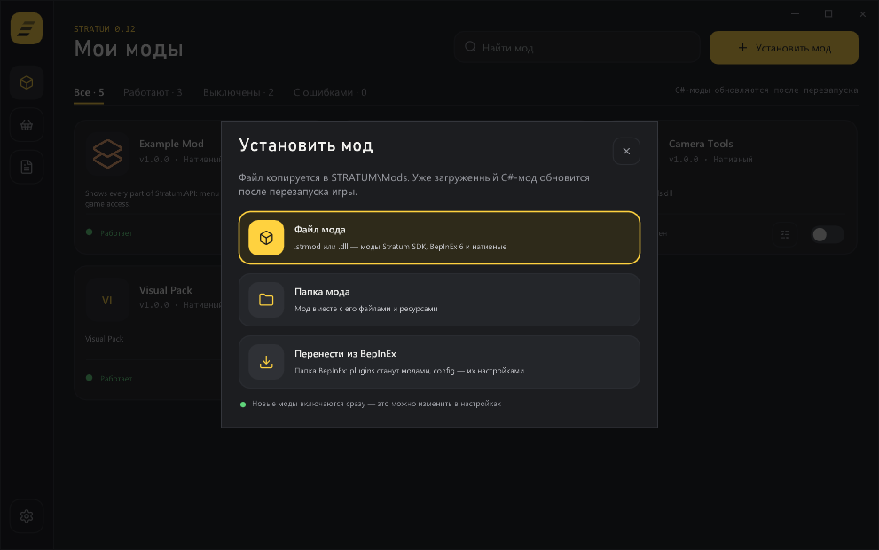
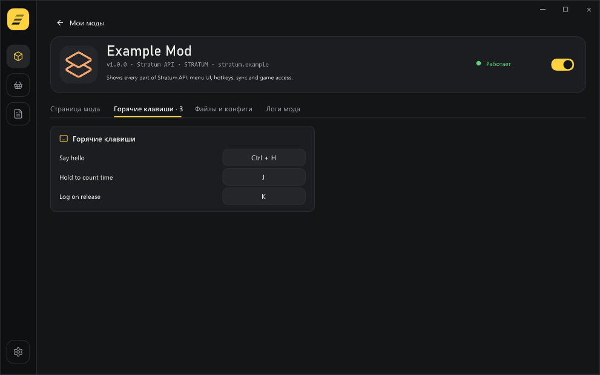
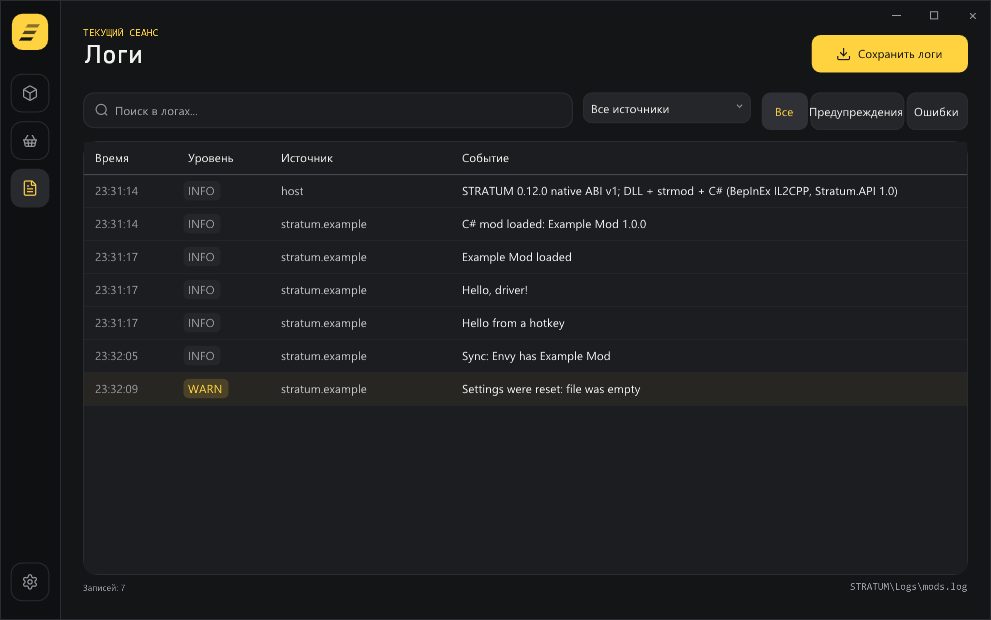
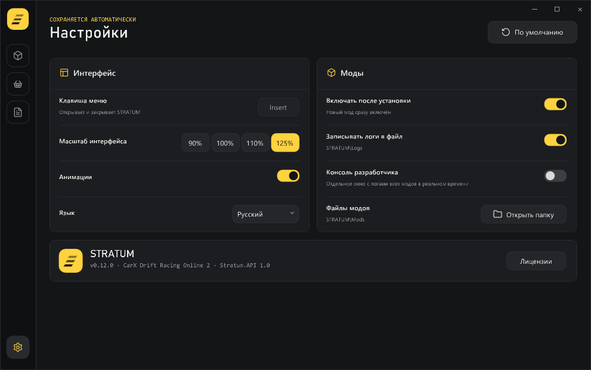
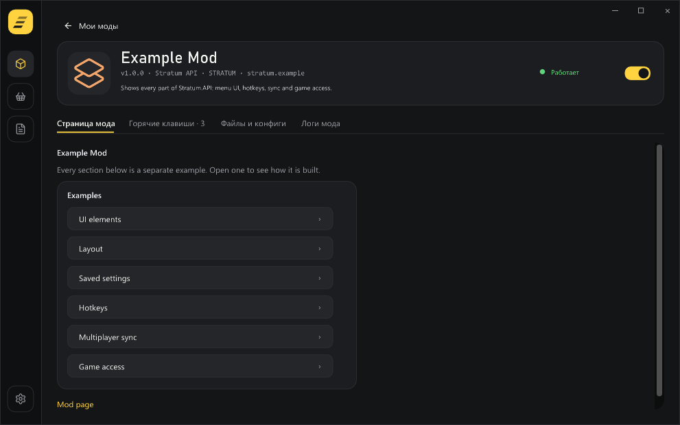
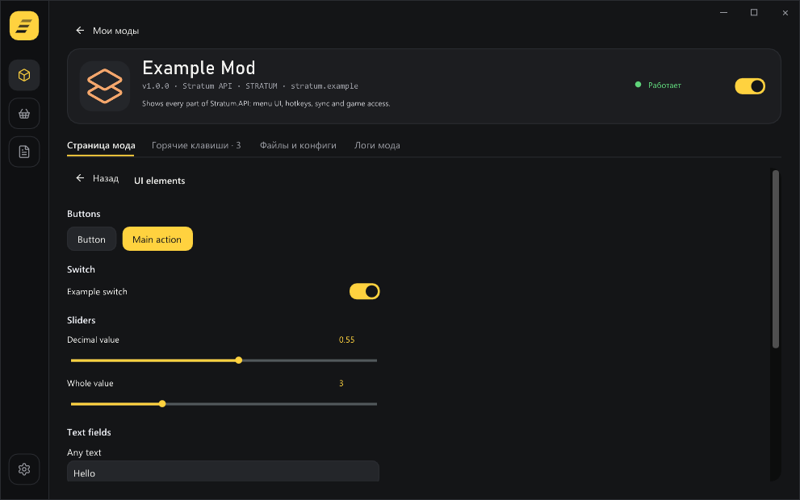
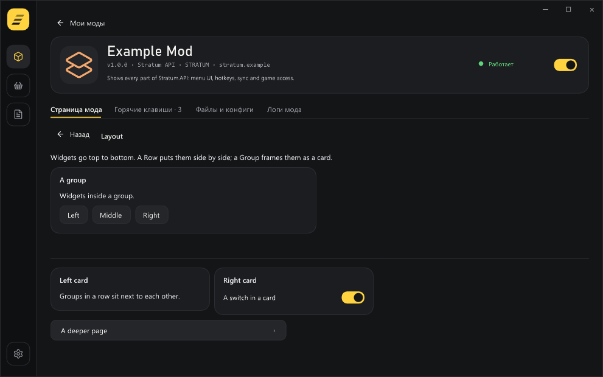
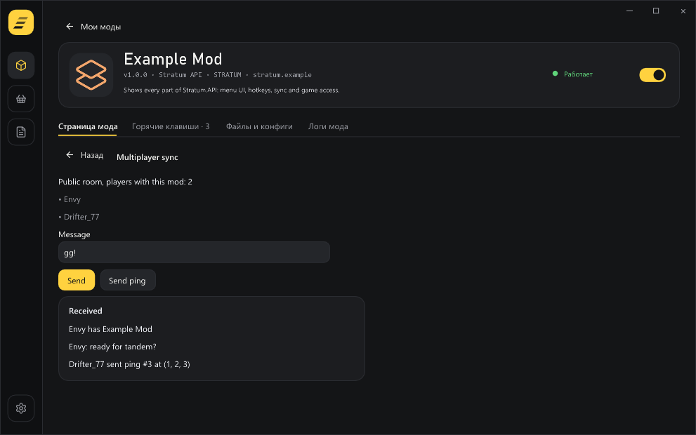

# STRATUM and Stratum SDK — complete guide

STRATUM is an in-game mod loader for **CarX Drift Racing Online 2** (Windows x64); press **Insert** in the game to open its menu.
Stratum SDK is the kit for C# mods: the **Stratum.API** library, a packer, a template and a full example.

> Versions: STRATUM **0.13.0**, Stratum.API **1.0.0**. Русская версия: [GUIDE-RU.md](GUIDE-RU.md).

- [Part 1. For players](#part-1-for-players)
- [Part 2. For modders](#part-2-for-modders)

---

## Part 1. For players

### Installing STRATUM

1. Close the game.
2. Copy **winhttp.dll** into the game folder, next to `CarX Drift Racing Online 2.exe` (Steam → right-click the game → **Manage** → **Browse local files**).
3. For C# mods, install the free **[Microsoft .NET 8 Runtime (x64)](https://dotnet.microsoft.com/download/dotnet/8.0)** once. Without it only native mods run; C# mods show a hint in the menu.
4. Start the game through Steam. A **STRATUM** folder appears next to the game, and on the first run the menu opens by itself so you can pick a language (change it later in **Settings**).



> Coming from BepInEx: remove `doorstop_config.ini`, the `BepInEx` and `dotnet` folders and BepInEx's `winhttp.dll`. STRATUM replaces them and runs BepInEx 6 IL2CPP mods itself.

### The menu

**Insert** opens and closes it.



The rail on the left holds the sections: **My mods** shows installed mods as cards (tabs filter all / running / disabled / with errors; the switch turns a mod on or off; clicking a card opens its page), **Catalog** is reserved for the mod catalog, **Logs** shows loader and mod events including BepInEx mods, and **Settings** (bottom) has scale, animations, language, auto-enable, file logs and the developer console.

### Installing mods

Use **Install mod** → **Mod file** (a `.strmod`/`.dll`), **Mod folder**, or **Move from BepInEx** (a whole old `BepInEx` folder: its `plugins` become mods, its `config` goes to `STRATUM\Configs\Legacy`). Or drop files into `STRATUM\Mods` while the game is closed.



| Kind | Example | Needs |
|---|---|---|
| Stratum SDK mods (`.strmod`/`.dll`) | Example Mod | .NET 8 |
| BepInEx 6 IL2CPP mods | NeXT, XMetrics, KEF TV | .NET 8 |
| Native mods (C++ / C# Native AOT) | HelloNative | — |

BepInEx 5 / Mono mods are not supported. Enabling or disabling a C# mod applies **after a game restart**.

### Mod settings, hotkeys, logs

Click a mod card to open its page. Tabs: **Mod page** (what the mod draws), **Hotkeys** (click a combination, then press new keys; **Esc** cancels, **Backspace** clears, the arrow button restores the default), **Files and configs** (type, version, file, load errors, folders) and **Mod logs**.





*Example entries from Example Mod.*

**Developer console.** **Settings → Developer console** opens a separate window with every log line in real time: STRATUM, Stratum SDK mods and BepInEx mods, warnings in yellow and errors in red, starting with the session so far. Turn it off with the same switch (the window's close button is removed because closing a console window would also close the game).



```text
<game folder>\
├── winhttp.dll              ← STRATUM
└── STRATUM\
    ├── Mods\                ← mods
    ├── Configs\             ← STRATUM and mod settings (<mod id>\, Legacy\ for BepInEx configs)
    └── Logs\                ← loader.log, mods.log, compatibility.log
```

---

## Part 2. For modders

Stratum.API works much like the KSL SDK: write a normal C# library, derive the mod class and get a **log, a page in the STRATUM menu, rebindable hotkeys and messages between players**. The game itself (Unity and CarX classes) is directly accessible, as in BepInEx IL2CPP mods.

### 1. Requirements

**[.NET 8 SDK](https://dotnet.microsoft.com/download/dotnet/8.0)** or newer; Visual Studio 2022, Rider or VS Code with C# Dev Kit; the game with **STRATUM 0.12+**.

### 2. SDK contents

```text
STRATUM-SDK-1.0.0\
├── API\Stratum.API.dll, Stratum.API.xml
├── tools\Get-GameReferences.ps1   ← copies the game's reference assemblies out of STRATUM
├── tools\Build-Mod.ps1            ← builds a mod and packs a .strmod
├── tools\stratum-pack.exe         ← the packer
├── template\MyMod\                ← minimal project
├── examples\ExampleMod\           ← every feature, with comments (+ prebuilt\ExampleMod-1.0.0.strmod)
├── refs\                          ← filled by Get-GameReferences.ps1
└── docs\
```

### 3. First mod in 5 minutes

```powershell
# 1. Game references (repeat after game or STRATUM updates)
.\tools\Get-GameReferences.ps1 -Game "C:\Program Files (x86)\Steam\steamapps\common\CarX Drift Racing Online 2"
# 2. Copy template\MyMod to template\DriftTimer, rename the .csproj and AssemblyName
# 3. Edit [StratumMod(...)] in the .cs file and the same fields in manifest.ini
# 4. Build and pack
.\tools\Build-Mod.ps1 -Project .\template\DriftTimer
# 5. Copy template\DriftTimer\dist\DriftTimer-1.0.0.strmod to STRATUM\Mods and start the game
```

```csharp
[StratumMod("myname.drifttimer", "Drift Timer", "1.0.0", Author = "MyName", Description = "Drift timer")]
public sealed class DriftTimer : StratumMod
{
    public override void OnLoad() => Log.Info("Drift Timer loaded");
}
```

Mod ids use lowercase letters, digits, `.`, `_`, `-` (for example `nick.mod`). Keep the id stable: settings and Sync use it. If PowerShell blocks scripts, run `Set-ExecutionPolicy -Scope CurrentUser RemoteSigned` once.

### 4. Mod lifecycle

| Override | Called |
|---|---|
| `OnLoad()` | once, when the game is running |
| `OnUpdate(float deltaTime)` | every frame |
| `OnDrawUI()` | while the player has the mod's "Mod page" tab open (~30 times a second) |
| `OnQuit()` | when the game closes |
| `GetIcon()` | once at load: PNG bytes or `null` |

**Everything runs on the Unity main thread**, so game objects are safe to use from any callback, including page code. Members: `Log`, `UI`, `Input`, `Sync`, `ConfigDirectory` (`STRATUM\Configs\<id>`), `Id`, `Name`, `Version`. An exception in `OnLoad`/`OnUpdate` stops the mod and shows the error in the menu; the game keeps running.

### 5. The mod's page (UI)

Immediate mode, as in KSL: describe the page in `OnDrawUI` every time; interactive widgets return `true` when used.

```csharp
bool enabled = true; float power = 0.5f;
public override void OnDrawUI()
{
    UI.Header("Settings");
    if (UI.Toggle("Enabled", ref enabled)) Log.Info("Enabled: " + enabled);
    UI.Slider("Power", ref power, 0, 1, step: 0.05f);
    if (UI.Button("Reset", primary: true)) power = 0.5f;
}
```



| Method | |
|---|---|
| `Label`, `Header`, `Hint` | text, heading, muted text |
| `Separator()`, `Space(h)` | line, gap |
| `Button(label, tooltip, primary)` | `true` after a click |
| `Toggle(label, ref bool)` | `true` when changed |
| `Slider(label, ref float, min, max, step)` / `Slider(label, ref int, min, max)` | sliders |
| `Input(label, ref string, maxLength, hint)` | text field |
| `Dropdown(label, ref int, options)` | drop-down list |
| `Progress(label, 0..1)` | progress bar |
| `Link(text, url)` | opens http(s) in the browser |
| `PageButton(label, draw, title)`, `Back()` | nested pages; the menu shows Back |
| `using (UI.Row())`, `using (UI.Group("Title"))` | side by side; a card |





Labels are widget ids; add a hidden suffix with `##` when two widgets share a label (`UI.Button("Delete##slot2")`). Keep values in fields. Input arrives one frame later. Page code only runs while the page is open — put always-on logic in `OnUpdate`.

### 6. Hotkeys

```csharp
Input.Bind("hello", "Say hello", () => Log.Info("Hello"), Key.LeftCtrl, Key.H);          // Press
Input.Bind("boost", "Boost", Boost, HotkeyMode.Hold, Key.LeftShift, Key.B);             // every frame while held
Input.Bind("photo", "Screenshot", TakePhoto, HotkeyMode.Release, Key.F9);               // on release
UI.Hint("Boost: " + Input.Describe("boost"));   // the player's current combination
```

Players rebind them on the mod's page; the choice is saved in `STRATUM\Configs\<id>\hotkeys.cfg`. Up to three modifiers plus one key; matching is exact. `Input.IsHeld(id)`. Hotkeys pause while the STRATUM menu is open or the game is not focused.

### 7. Multiplayer (Sync)

Messages reach players **in the same online room who have the same mod**.

```csharp
Sync.On("chat", m => Log.Info(m.Sender.Name + ": " + m.Text));
Sync.On("score", m => { var r = m.Read(); int points = r.ReadInt(); float angle = r.ReadFloat(); });
Sync.PlayerJoined += p => Log.Info(p.Name + " has the mod");
if (Sync.IsAvailable) Sync.Send("score", new SyncWriter().Write(1200).Write(42.5f));
```



It rides on the game's own SmartFox server (user variables — the channel CarX uses for player state); no extra server is needed.

| | |
|---|---|
| Latency | usually 0.5–5 s |
| Batching | queued messages go out together every 0.5 s |
| Size | message ≤ 512 bytes; batch ≤ 1536 bytes (`Send` returns `false` beyond) |
| Reliability | a missed batch (e.g. a player just joined) is lost — resend important state, e.g. on `PlayerJoined` |
| Good for | events, shared state, scores, settings |
| Not for | per-frame data, real-time positions |

`Sync.Players` lists players with the mod; `Sync.IsPrivateRoom` tells whether the room was joined with a password. Use Sync responsibly; CarX's rules apply to mods too.

### 8. Game access

Add references from `refs` with `Private=false` (STRATUM provides them at runtime):

```xml
<Reference Include="CarX.DR3.Assembly"><HintPath>$(StratumSdk)\refs\CarX.DR3.Assembly.dll</HintPath><Private>false</Private></Reference>
```

```csharp
var camera = UnityEngine.Camera.main;
if (camera != null) camera.fieldOfView = 80;
```

The game's classes work as in BepInEx IL2CPP mods (Il2CppInterop: `TryCast<T>()`, `Il2CppSystem.*` collections). HarmonyX (`0Harmony.dll` in `refs`) is available.

> **CS0656 (NullableAttribute):** the game's `UnityEngine.CoreModule` declares its own `NullableAttribute`. Keep `NullableAttributes.cs` from the template in your project.

### 9. Saving settings

Use `ConfigDirectory`; see `examples\ExampleMod\Settings.cs` for a JSON example.

### 10. Logo

`.strmod`: put `icon.png` next to the project (square PNG, 256 or 512 px) — `Build-Mod.ps1` packs it. `.dll`: embed it and return `LoadEmbeddedResource("MyMod.icon.png")` from `GetIcon()`.

### 11. Packing

`manifest.ini`: `id` (must match `[StratumMod]`), `name`, `version` (major.minor.patch), optional `author`, `description`.

```powershell
.\tools\stratum-pack.exe pack bin\Release\net8.0\DriftTimer.dll manifest.ini icon.png DriftTimer-1.0.0.strmod
.\tools\stratum-pack.exe inspect DriftTimer-1.0.0.strmod   # abi=2 (C# Stratum.API)
```

### 12. Troubleshooting

The quickest view is the **developer console** (Settings → Developer console): your `Log.*` calls and exceptions show up there at once. Also: menu → **Logs** (filter by your mod), or `STRATUM\Logs\mods.log` (mod messages), `compatibility.log` (C# layer details), `loader.log`.

| Problem | Fix |
|---|---|
| `CS0656 … NullableAttribute` | add `NullableAttributes.cs` from the template |
| `UnityEngine`/`Camera` not found | run `Get-GameReferences.ps1`; add the reference |
| Menu says to install .NET 8 | the player needs .NET 8 Runtime x64 |
| "Недопустимый id мода" (invalid id) | lowercase Latin letters, digits, `.`, `_`, `-` only |
| No `StratumMod` class / missing attribute | derive from `StratumMod`, add `[StratumMod]` |
| Mod stopped after `OnUpdate` error | see the stack trace in the log |
| Changes not applied | C# mods update after a game restart |
| `Sync.Send` is `false` | not in a room, message > 512 bytes, or batch full |

### 13. KSL → Stratum.API

| KSL | Stratum.API |
|---|---|
| `[KSLMeta]`, `BaseMod`, `Start()`, `OnUIDraw()` | `[StratumMod]`, `StratumMod`, `OnLoad()`, `OnDrawUI()` |
| `Kino.Log`, `Kino.UI`, `Kino.Input`, `Kino.Sync` | `Log`, `UI`, `Input`, `Sync` (properties of your mod) |
| `ContextButton` + `PushContext` / `PopContext` | `PageButton` / `Back` |
| `BeginHorizontal` / `EndHorizontal` | `using (UI.Row())` |
| `CreatePacket` + `SendToAll` | `Sync.Send(channel, new SyncWriter()...)` |
| `Kino.Prefs` / `Kino.Config` | your own file in `ConfigDirectory` |
| maykr → `.ksm` | `Build-Mod.ps1` / `stratum-pack` → `.strmod` |
